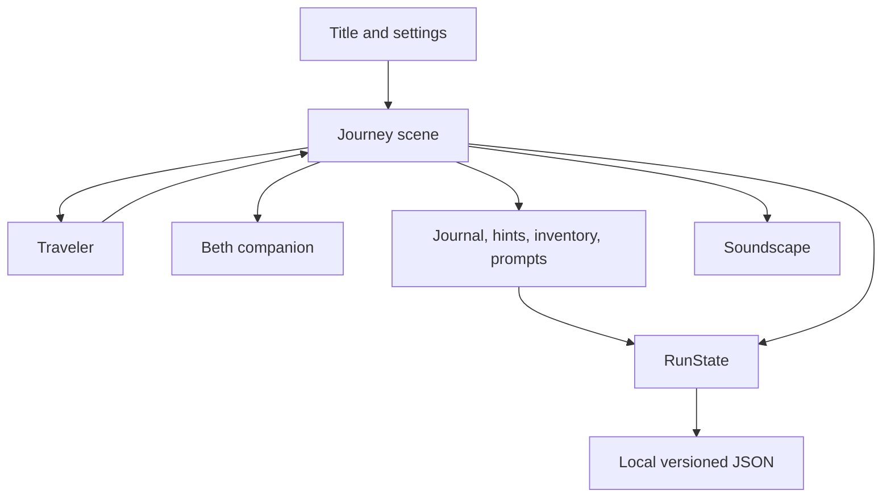

# Architecture

## Current project map

- `project.godot`: startup scene, display settings, autoloads, rendering.
- `src/core/run_state.gd`: global state, input map, settings, JSON save, inventory, journal IDs, hint counter.
- `src/audio/soundscape.gd`: generated sound streams and area ambience.
- `src/actors/traveler.gd`, `beth.gd`: player and companion.
- `src/scenes/main_menu.gd`: menu, settings, controls, and remapping UI.
- `src/scenes/prologue.gd`: current route, puzzle flow, HUD, hand-drawn environment, and item interactions. This script is intentionally a prototype and is now large; split it before adding substantial chapters.
- `src/scenes/ending.gd`: cliffhanger presentation.
- `design/assets/`: original project artwork and credits.

## Runtime relationships

## Refactor direction

Keep one owner for each persistent value. Move world state into RunState, area drawing and transitions into world/area scripts, interaction prompts into reusable interactables, and HUD panels into UI scripts when new content makes that separation useful. Avoid building empty abstractions ahead of a need.

